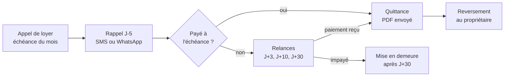
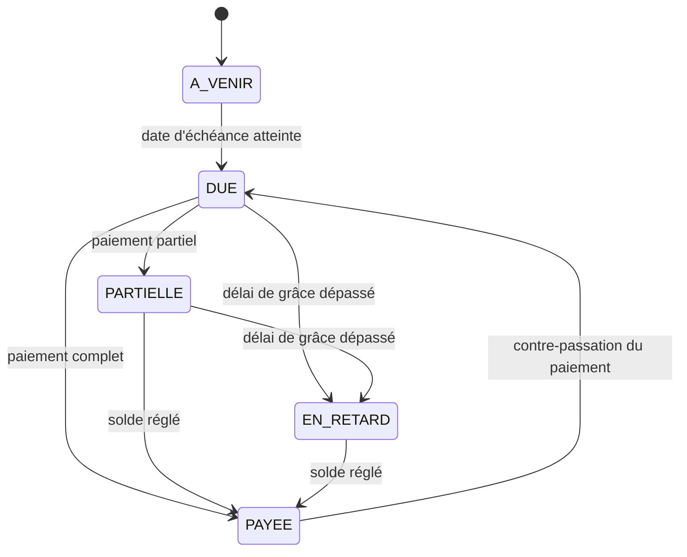
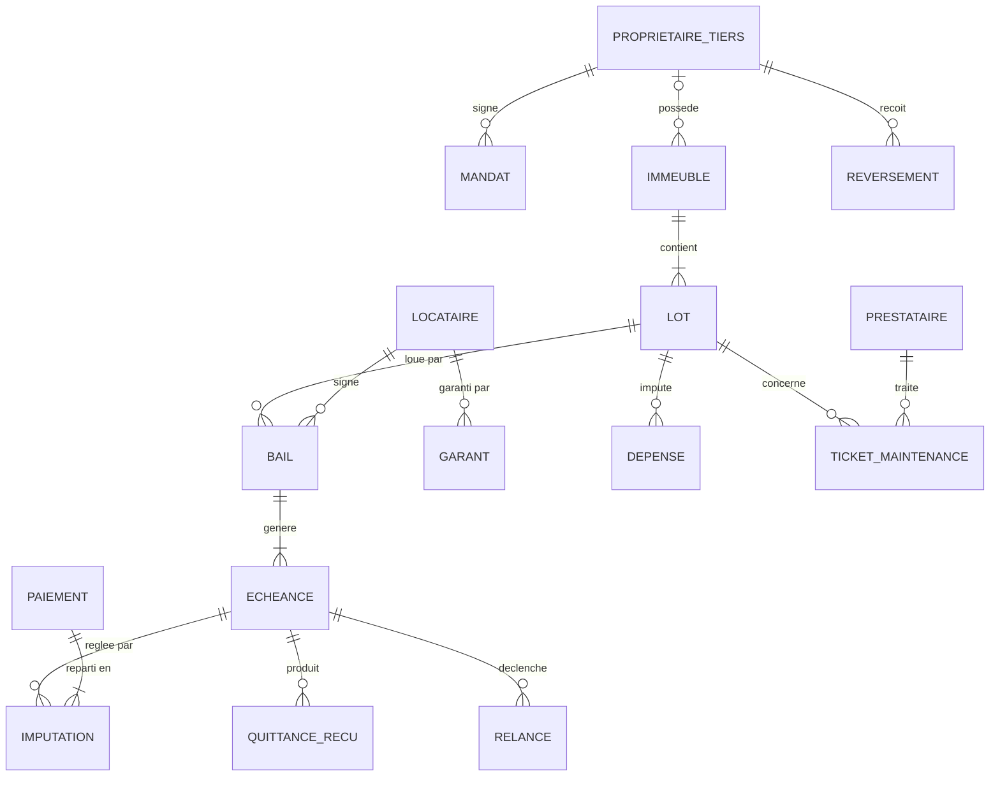
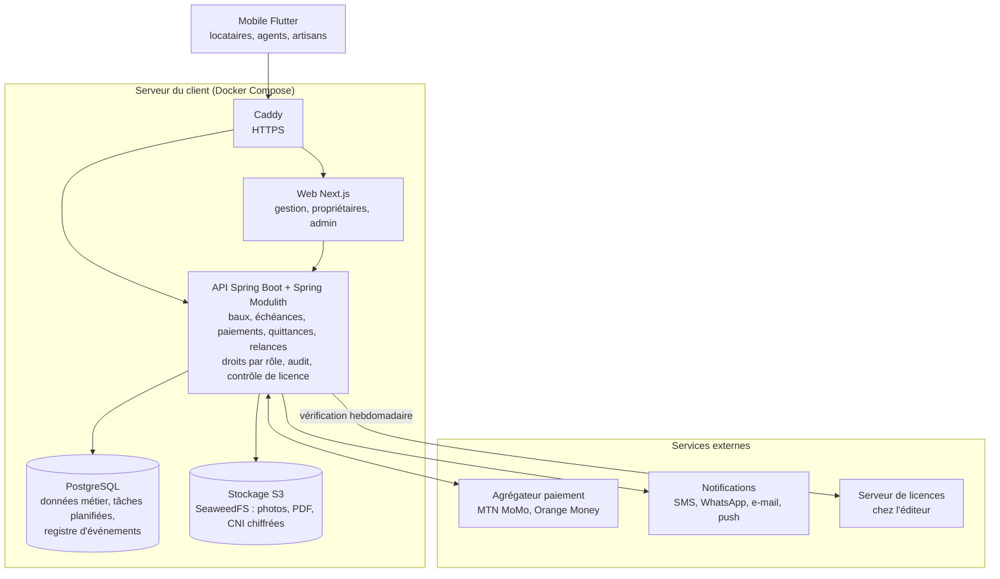

# Analyse – Application de gestion immobilière

Version du 3 novembre 2026. Source : document d'analyse partagé (Claude Docs). En cas d'écart, ce fichier fait foi pour Claude Code.

## 1. Contexte, objectifs et hypothèses

L'application centralise la gestion d'un parc immobilier locatif : biens, locataires, baux, loyers, charges et maintenance, avec paiement mobile et espace en ligne pour chaque acteur. Ce n'est pas un SaaS : le client (propriétaire ou agence) installe l'application sur son propre serveur ou ordinateur, reste maître de ses données et paie une licence annuelle. Le MVP vise un client gérant de 10 à 500 lots.

**Objectifs mesurables**

- Réduire le temps de suivi des loyers : relances et quittances automatiques au lieu d'un suivi manuel (Excel, cahier).
- Réduire les impayés grâce aux rappels SMS/WhatsApp et au paiement Mobile Money.
- Donner au propriétaire une vision en temps réel : taux d'occupation, encaissements, arriérés.
- Tracer chaque intervention de maintenance, du signalement à la clôture.

**Hypothèses de cadrage (à valider)**

- Marché cible : Cameroun puis Afrique centrale (zone CEMAC), monnaie FCFA (XAF), interface en français puis anglais.
- Paiements des loyers : MTN Mobile Money et Orange Money via le compte marchand du client lui-même, espèces et virement saisis manuellement.
- Cible principale : propriétaires gérant leur propre parc ; agences gérant pour compte de tiers en second.
- Modèle économique : licence annuelle par installation, tarif par palier de lots (ex. jusqu'à 50, 200, 500 lots), renouvelable chaque année ; installation, formation et support en option.
- Distribution : l'éditeur fournit l'installeur, les mises à jour et un serveur de licences ; il n'héberge aucune donnée client.
- Hors périmètre MVP : vente/transaction immobilière, syndic de copropriété complet, comptabilité générale.

## 2. Acteurs et rôles

Six rôles couvrent les besoins ; chacun ne voit que les données de son périmètre (bien ou bail).

| Rôle | Qui | Besoins principaux | Interface |
| --- | --- | --- | --- |
| Éditeur | Vous (vendeur du logiciel) | Émettre et renouveler les licences, publier les mises à jour ; aucun accès aux données du client | Portail de licences |
| Administrateur | Le client qui a acheté la licence | Installation, utilisateurs, droits, paramètres, activation de la licence, sauvegardes | Web |
| Gestionnaire | Le client ou ses employés | Biens, baux, encaissements, relances, états des lieux | Web + mobile |
| Propriétaire tiers | Mandant, si le client est une agence | Suivi revenus, occupation, reversements, documents | Web + mobile |
| Locataire | Occupant | Payer le loyer, télécharger quittances, signaler une panne | Mobile (prioritaire) |
| Prestataire | Plombier, électricien… | Recevoir et clôturer des interventions | Mobile (simple) |

Un comptable externe peut obtenir un accès en lecture seule aux encaissements et exports (option V2).

## 3. Périmètre fonctionnel

Le MVP couvre le cycle locatif complet (bien → bail → loyer → quittance → relance) ; la V2 ajoute l'automatisation avancée et les services annexes.

| Module | Fonctionnalités | Priorité |
| --- | --- | --- |
| Installation et licence | Installeur guidé, assistant de premier lancement, activation par clé de licence, alerte avant expiration, renouvellement, mises à jour, sauvegarde/restauration | MVP |
| Patrimoine | Immeubles, lots (appartement, studio, boutique, bureau, terrain), photos, équipements, compteurs, statut libre/occupé/en travaux | MVP |
| Propriétaires tiers | Fiche, biens rattachés, mandat de gestion, taux d'honoraires, coordonnées de reversement (utile si le client est une agence) | MVP |
| Locataires | Fiche, pièces d'identité, garants, historique de paiements, notation de solvabilité | MVP |
| Baux | Création depuis modèle, durée, loyer, charges, caution, avance (ex. 3 à 12 mois), échéance, renouvellement, résiliation, PDF généré | MVP |
| Loyers et encaissements | Appels de loyer automatiques, saisie espèces/virement, paiement Mobile Money, paiements partiels, lettrage | MVP |
| Quittances et reçus | Génération PDF automatique à chaque paiement complet, envoi SMS/WhatsApp/e-mail | MVP |
| Relances et impayés | Rappel avant échéance, relances J+3, J+10, J+30, liste des arriérés, mise en demeure | MVP |
| Tableaux de bord | Occupation, encaissé vs attendu, arriérés par bien et par locataire, baux arrivant à échéance | MVP |
| Reversements propriétaires | Calcul loyers perçus − honoraires − dépenses, relevé de gérance mensuel PDF | MVP |
| Maintenance | Ticket locataire avec photo, affectation prestataire, devis, suivi, coût imputé au propriétaire | V2 |
| États des lieux | Entrée/sortie sur mobile avec photos par pièce, signature, comparaison | V2 |
| Dépenses et charges | Factures, répartition des charges communes (eau, électricité, gardiennage), régularisation | V2 |
| Documents (GED) | Stockage baux, pièces, contrats, recherche et partage | V2 |
| Annonces et prospects | Publication des lots libres, gestion des visites et candidatures | V2 |
| Signature électronique | Signature du bail et de l'état des lieux en ligne | V2 |
| Messagerie | Fil de discussion gestionnaire ↔ locataire / propriétaire | V2 |
| Exports comptables | Export Excel/CSV, journal des encaissements, format compatible SYSCOHADA | V2 |

Côté éditeur, un **portail de licences** séparé (MVP) gère les clients, la génération des clés, l'encaissement des licences et la diffusion des mises à jour.

## 4. Règles de gestion et processus clés

Le moteur d'échéances génère chaque mois un appel de loyer par bail actif ; tout le reste (quittance, relance, reversement) découle de son statut.

**Règles de gestion**

1. Un lot ne peut avoir qu'un seul bail actif à une date donnée.
2. Un bail porte : loyer, charges, périodicité (mensuelle, trimestrielle, annuelle), jour d'échéance, caution, nombre de mois d'avance.
3. L'avance versée à la signature solde automatiquement les premières échéances.
4. Statut d'une échéance : à venir → due → partiellement payée → payée, ou en retard après le délai de grâce (paramétrable, ex. 5 jours).
5. Un paiement est imputé d'abord sur l'échéance la plus ancienne.
6. La quittance n'est émise que pour une échéance entièrement payée ; un paiement partiel donne un reçu.
7. Un paiement Mobile Money n'est validé qu'après confirmation de l'opérateur (webhook), jamais sur simple déclaration.
8. Honoraires de gestion = pourcentage des loyers encaissés, fixé par mandat.
9. Reversement propriétaire = loyers encaissés − honoraires − dépenses imputées, calculé à date fixe.
10. Restitution de caution à la sortie = caution − retenues justifiées par l'état des lieux et les arriérés.
11. Tout encaissement ou annulation est historisé (auteur, date, motif) et ne peut pas être supprimé, seulement contre-passé.

**Règles de licence**

1. Une licence = un client, une installation, une date d'expiration (12 mois) et un palier de lots maximum.
2. La clé est un fichier signé numériquement par l'éditeur (Ed25519) et liée à l'empreinte du serveur ; l'application vérifie la signature sans connexion.
3. Une vérification en ligne a lieu au plus une fois par semaine ; sans réseau, l'application tolère 30 jours de grâce.
4. Alertes à l'administrateur 30, 15 et 7 jours avant l'expiration.
5. Licence expirée : passage en lecture seule (consultation et export possibles, plus de création ni d'encaissement) ; aucune donnée n'est supprimée.
6. Dépassement du palier de lots : création de nouveaux lots bloquée jusqu'à mise à niveau.
7. Changement de serveur : transfert de licence depuis le portail éditeur, l'ancienne installation est désactivée.

**Processus principaux**

1. Entrée d'un locataire : candidature → vérification des pièces → rédaction du bail → encaissement caution + avance → état des lieux d'entrée → lot « occupé ».
2. Cycle mensuel du loyer : diagramme ci-dessous.
3. Sortie : préavis → état des lieux de sortie → solde de tout compte → restitution caution → lot « libre ».
4. Maintenance : signalement → qualification → devis → validation propriétaire si au-delà d'un seuil → intervention → clôture et imputation.

**Cycle mensuel du loyer** — chaque échéance finit en quittance ou en relance.

Un paiement partiel produit un reçu et laisse l'échéance ouverte : elle reste dans le circuit des relances jusqu'au solde.

**Statuts d'une échéance**

## 5. Modèle de données

Le cœur du modèle est la chaîne Lot → Bail → Échéance → Paiement ; chaque installation a sa propre base, donc pas de cloisonnement multi-tenant (pas d'`agence_id`).

| Entité | Attributs clés | Relations |
| --- | --- | --- |
| Paramètres client | nom, logo, devise, paramètres de relance, compte Mobile Money marchand | 1 seul enregistrement par installation |
| Licence | clé signée, client, palier de lots, date d'expiration, empreinte serveur, dernière vérification | 1 par installation |
| Utilisateur | nom, téléphone, e-mail, rôle, mot de passe/OTP | — |
| Propriétaire tiers | identité, contact, mode de reversement | 1 → n Mandats, Immeubles |
| Mandat | taux d'honoraires, date début/fin | n → 1 Propriétaire tiers |
| Immeuble | adresse, quartier, ville, GPS, photos | 1 → n Lots ; n → 0..1 Propriétaire tiers |
| Lot | référence, type, surface, pièces, loyer indicatif, statut | n → 1 Immeuble ; 1 → n Baux |
| Locataire | identité, CNI, profession, contact | 1 → n Baux, Garants |
| Bail | dates, loyer, charges, périodicité, caution, avance, statut | n → 1 Lot, n → 1 Locataire ; 1 → n Échéances |
| Échéance | période, montant dû, montant payé, statut, date limite | n → 1 Bail ; n ↔ n Paiements (via Imputation) |
| Paiement | montant, moyen (MoMo, OM, espèces, virement), référence opérateur, statut | 1 → n Imputations ; 1 → 0..1 Quittance |
| Quittance / Reçu | numéro, PDF, date d'envoi | n → 1 Échéance |
| Relance | canal, niveau (J+3, J+10…), date, résultat | n → 1 Échéance |
| Reversement | période, brut, honoraires, dépenses, net, statut | n → 1 Propriétaire tiers |
| Dépense | nature, montant, facture, imputation | n → 1 Lot ou Immeuble |
| Ticket maintenance | description, photos, priorité, statut, coût | n → 1 Lot ; n → 1 Prestataire |
| Fichier | clé S3, nom d'origine, type MIME, taille, sha256, entité propriétaire | n → 1 entité (polymorphe) |
| Document | type, fichier, entité liée | polymorphe (Bail, Locataire, Lot…) |
| Journal d'audit | auteur, action, avant/après, date | toutes entités |

Le portail éditeur a sa propre base, minimale : Clients, Licences, Paiements de licence, Versions publiées.

## 6. Exigences non fonctionnelles

La contrainte n°1 est la connectivité : l'app mobile doit rester utilisable sur réseau 3G instable et smartphones Android d'entrée de gamme.

| Domaine | Exigence | Cible |
| --- | --- | --- |
| Installation | Installation par un non-informaticien ou un technicien local | < 30 min, installeur unique (Docker ou Windows) |
| Mises à jour | Téléchargement et application des nouvelles versions | En un clic, migration de base automatique, retour arrière possible |
| Performance | Temps de chargement d'un écran | < 2 s en 3G |
| Mobile | Mode hors ligne (consultation + saisie différée des encaissements et états des lieux) | Synchronisation automatique au retour du réseau |
| Mobile | Taille de l'app Android | < 30 Mo, Android 8+ |
| Matériel minimum | Serveur ou PC du client | 2 cœurs, 4 Go RAM, 20 Go disque |
| Licence | Protection contre la copie et la falsification | Clé signée, code backend compilé ou obfusqué |
| Sécurité | Authentification par OTP SMS ou mot de passe + 2FA pour gestionnaires | Sessions expirées après 30 min d'inactivité |
| Sécurité | Chiffrement | HTTPS (certificat automatique), données sensibles (CNI) chiffrées au repos |
| Droits | Contrôle d'accès par rôle | Un locataire ne voit que son bail |
| Traçabilité | Journal d'audit des opérations financières | Conservation 10 ans |
| Sauvegarde | Base et fichiers, sous la responsabilité du client | Automatique quotidienne, copie externe (disque, cloud du client), restauration en un clic |
| Conformité | Protection des données personnelles | Loi camerounaise n°2024/017 sur les données personnelles — à vérifier avec un juriste |
| Langues | Français et anglais | Textes externalisés dès le MVP |
| Volume | Nombre de lots par installation | 5 000 lots sans dégradation |

## 7. Architecture technique

Chaque client installe un paquet unique (API, web, base, stockage S3, tâches) sur son propre serveur ; l'app mobile s'y connecte et seul le serveur de licences reste chez l'éditeur.

L'API appelle l'agrégateur de paiement avec le compte marchand du client et reçoit sa confirmation par webhook. Pour cela, et pour que les locataires utilisent l'app mobile, le serveur doit être joignable depuis Internet : un VPS du client est l'option la plus simple ; un PC au bureau demande un tunnel (ex. Cloudflare Tunnel) ou se limite au réseau local. Le stockage S3 n'est jamais exposé : seule l'API y accède.

| Couche | Choix retenu | Raison |
| --- | --- | --- |
| Backend | Java 21, Spring Boot 3.x, Spring Security (JWT), Spring Data JPA | Robuste, typé, jar compilé plus difficile à copier |
| Modularité | Spring Modulith : un module par domaine (patrimoine, bail, finance…), frontières vérifiées en CI, événements entre modules avec registre de publication (outbox) | Monolithe simple à installer chez le client, mais découpé proprement |
| Base de données | PostgreSQL 16 + Flyway | Intégrité transactionnelle pour les montants, migrations maîtrisées à chaque mise à jour |
| Stockage de fichiers | Stockage objet compatible S3 (AWS SDK v2) ; SeaweedFS livré par défaut, MinIO, RustFS ou AWS S3 branchables par configuration | MinIO communautaire n'est plus maintenu (images arrêtées en octobre 2025, dépôt archivé) ; SeaweedFS est sous Apache 2.0 et maintenu |
| Tâches planifiées | db-scheduler ou Quartz JDBC (en base) | Pas de Redis à installer chez le client |
| PDF | Thymeleaf + OpenHTMLtoPDF | Quittances, reçus, baux, relevés |
| Web | Next.js 15 (App Router, TypeScript), Tailwind, shadcn/ui, TanStack Query | Tableaux de bord et formulaires riches |
| Mobile | Flutter (Android d'abord), Riverpod, drift (SQLite) | Une base de code, hors ligne ; l'app demande l'adresse du serveur du client (QR code) |
| Contrat d'API | OpenAPI généré par springdoc → clients TypeScript et Dart générés | Web et mobile toujours alignés sur le backend |
| Paiement | Agrégateur (CinetPay, Campay, NotchPay…), compte du client | Intégration unique pour MTN et Orange |
| Notifications | WhatsApp Cloud API + fournisseur SMS + Firebase + SMTP, clés saisies par le client | Coût et taux de lecture |
| Licence | Clés signées Ed25519 (JDK natif) + serveur et portail éditeur (Spring Boot + Next.js) | Vérification hors ligne |
| Packaging | Docker Compose (PostgreSQL, SeaweedFS, API, web, Caddy) + scripts install / update / backup ; jar obfusqué ProGuard | Installation et mises à jour reproductibles |
| Qualité | GitHub Actions, JUnit 5 + Testcontainers, tests de modules Spring Modulith, Vitest + Playwright, flutter_test | Chaque version testée en mise à jour depuis la précédente |

## 8. Planning, lots et estimation

Le MVP peut être mis en pilote en environ 23 semaines (5 à 6 mois) avec une équipe de 5 à 6 personnes, soit environ 24 mois-homme, licence et installeur compris. Le détail des étapes pour Claude Code est dans `docs/PLAN.md`.

| Phase | Durée | Contenu | Jalon de sortie |
| --- | --- | --- | --- |
| Cadrage | 3 semaines | Ateliers métier, maquettes UX, choix de l'agrégateur | Maquettes validées |
| MVP web + API | 10 semaines | Patrimoine, baux, loyers, quittances, relances, tableaux de bord, licence | MVP recetté |
| Mobile + paiement | 6 semaines | App Flutter, MTN MoMo / Orange Money, mode hors ligne | Paiement en production |
| Pilote | 4 semaines | 2 à 3 clients, import des données, corrections | Go commercial |

La V2 (maintenance, états des lieux, charges, signature électronique, annonces) suit le lancement sur environ 12 semaines, priorisée selon les retours du pilote.

| Profil | Affectation | Charge estimée (mois-homme) |
| --- | --- | --- |
| Chef de projet / Product owner | 100 % sur toute la durée | 5,5 |
| Développeurs backend + web (×2) | 100 % dès la fin du cadrage, dont licence, portail éditeur et mises à jour | 11 |
| Développeur mobile Flutter | 100 % à partir de la semaine 10 | 3,5 |
| Designer UX/UI | 50 % au cadrage, puis ponctuel | 1,5 |
| Testeur (QA), dont tests d'installation sur plusieurs machines | 50 % à partir de la semaine 6 | 2,5 |
| **Total** | | **≈ 24** |

Ces chiffres sont un ordre de grandeur à affiner après le cadrage ; le coût en FCFA dépend des taux journaliers de votre équipe ou prestataire.

## 9. Risques et points à trancher

Deux risques dominent : l'adoption (paiements en espèces non saisis) et, avec l'installation chez le client, le support de dizaines d'installations différentes et le piratage de licence.

| Risque | Impact | Parade |
| --- | --- | --- |
| Faible adoption par les gestionnaires | Données incomplètes, non-renouvellement de licence | Saisie mobile en 3 clics, import Excel des données existantes, formation à l'installation |
| Piratage ou partage de licence | Perte de revenus | Clé signée liée au serveur, vérification en ligne périodique, code obfusqué |
| Installations hétérogènes (Windows, Linux, versions) | Support coûteux, bugs difficiles à reproduire | Packaging Docker standard, configuration minimale exigée, outil de diagnostic intégré |
| Clients qui ne mettent pas à jour | Failles, versions multiples à maintenir | Mise à jour en un clic, support limité aux 2 dernières versions |
| Perte de données chez le client (panne disque, vol de PC) | Perte totale de l'historique | Sauvegarde automatique avec copie externe obligatoire à l'installation |
| Serveur non joignable depuis Internet | Pas de paiement MoMo en ligne ni d'app locataire | Recommander un VPS ou un tunnel, mode « réseau local » dégradé sinon |
| Paiements en espèces non tracés | Arriérés faux, litiges | Reçu SMS automatique au locataire à chaque saisie, rapprochement de caisse |
| Délais d'ouverture d'un compte marchand MoMo / Orange par le client | Paiement en ligne retardé | Agrégateur, accompagnement à l'ouverture du compte |
| Conformité données personnelles | Sanction, réputation | Le client est responsable de traitement ; fournir chiffrement et modèles de consentement |

**Points à trancher**

- [ ] Cible prioritaire : propriétaires individuels, agences, ou les deux dès le MVP ?
- [ ] Lieu d'installation recommandé : VPS du client, serveur au bureau, ou simple PC Windows ?
- [ ] Prix de la licence annuelle par palier de lots, et prix de l'installation et du support ?
- [ ] Que se passe-t-il à l'expiration : lecture seule (proposé) ou blocage complet ?
- [ ] Mises à jour incluses dans la licence annuelle, ou seulement les correctifs ?
- [ ] Application mobile native dès le MVP, ou web responsive d'abord ?
- [ ] Agrégateur de paiement recommandé aux clients et frais de transaction supportés par qui ?
- [ ] Pays de lancement au-delà du Cameroun et devises à gérer ?
